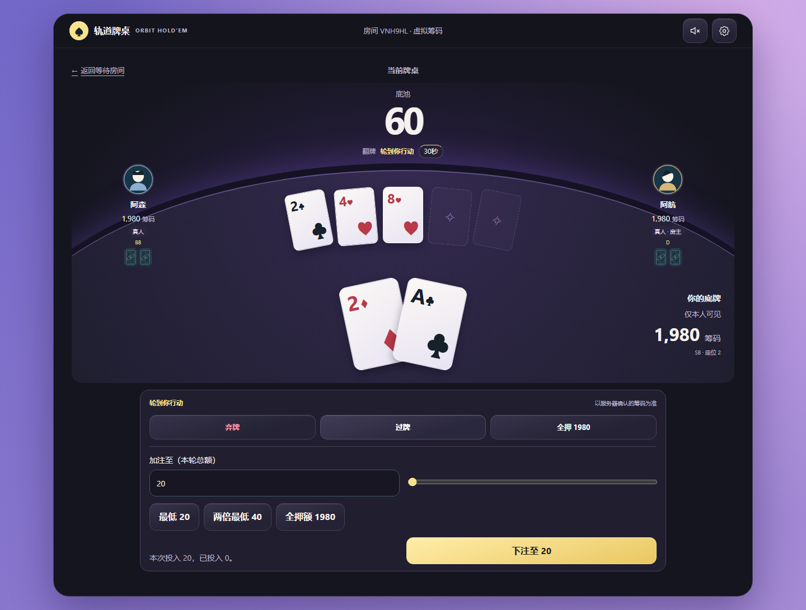

# ♠ Orbit Hold’em

**English** · [简体中文](README.zh-CN.md)

**Practice Texas Hold’em with virtual chips or invite friends to a table.**

Play with 2–4 seats. Practice against bots, or share a table with friends and bots. After each hand, open your history to replay the betting and see how the pot was settled.

[Play online](https://orbit-holdem-game.onrender.com/) · [Quick start](#quick-start) · [How to play](#how-to-play) · [Deploy to Render](#deploy-to-render) · [Project structure](#project-structure) · [Development and verification](#development-and-verification)



[View the home page](docs/showcase/orbit-home.png) · [View a four-player game on mobile](docs/showcase/orbit-table-mobile.png)

## Features

- **Three ways to play.** Practice solo, create a room, or join with a room code or invite link. Bots have Beginner and Standard difficulty levels.
- **Full Texas Hold’em rules.** Supports blinds, raises, all-ins, side pots, split pots, and refunds for unmatched bets. The betting controls distinguish your total bet for the round from the chips you need to add.
- **Reconnect and replay.** Reconnect with the same identity to reclaim your reserved seat. Replays show information that was public during the hand and your own hole cards.
- **Desktop and mobile layouts.** Choose two-color or four-color cards, change card backs, toggle sound, and reduce motion. Sound is off by default.

## Quick start

Use Node.js **24.14.1** and npm **11**. Asset and fixture checks use Python 3. See [`.node-version`](.node-version) and [`package.json`](package.json) for version requirements.

```sh
npm ci
npm run dev
```

Open the [local home page](http://127.0.0.1:5173/). The development command starts both the web app and the game server. You can join a room once the [readiness check](http://127.0.0.1:3001/health/ready) returns `{"status":"ready"}`.

You can play as a guest right away. See the [account setup guide](docs/account-auth.md) to enable Google sign-in or email accounts, and [`.env.example`](.env.example) for available variables.

## How to play

1. Choose **Solo practice** on the home page and pick the number and difficulty of the bots. To play with friends, choose **Create room** and share the room code or invite link.
2. Each player clicks **Ready**, then the host clicks **Start hand**. When testing multiplayer on one device, use separate browser sessions to keep guest identities distinct.
3. After settlement, get ready for the next hand or open **History** to replay a previous hand.

## Deploy to Render

[`render.yaml`](render.yaml) configures a free demo. It creates a Docker web service in Singapore that serves the web app, HTTP API, and Socket.IO from a single address. In Render, choose **New → Blueprint**, select this repository, and open the assigned `onrender.com` address after deployment.

Free instances spin down after about 15 minutes of inactivity. A cold start can take about a minute. SQLite data on a free instance is lost on spin-down, restart, or redeployment. [Render free tier limits](https://render.com/docs/free)

For a long-running deployment, use a single Docker Compose instance with a persistent volume. Completed hand history stays on the volume. Hands in progress are marked as interrupted after a restart. [Deployment guide](docs/deployment.md) · [Backup and restore](docs/backup-restore.md)

To host the frontend separately on Vercel, use [`vercel.json`](vercel.json). Set `VITE_ORBIT_SOCKET_ORIGIN` in Vercel to the Render HTTPS origin, and set `ORBIT_GUEST_WEB_ORIGIN` in Render to the exact Vercel HTTPS origin. Players on Vercel join the same rooms as guests.

## Project structure

The project uses npm workspaces. The frontend uses React, TypeScript, and Vite. The game server uses Node.js, Socket.IO, and SQLite.

| Directory                                    | Responsibility                                                |
| -------------------------------------------- | ------------------------------------------------------------- |
| [`apps/web`](apps/web)                       | Lobby, table, accounts, settings, and replays                 |
| [`apps/server`](apps/server)                 | Rooms, identity, synchronization, bot scheduling, and storage |
| [`packages/poker-core`](packages/poker-core) | Shuffling, hand rankings, betting, and pot settlement         |
| [`packages/protocol`](packages/protocol)     | Messages and view types shared by the client and server       |
| [`assets`](assets)                           | Cards, chips, avatars, and sounds                             |

[Technical report](docs/technical-report.md) · [Game rules](docs/product-rules.md) · [Protocol](docs/protocol.md)

## Development and verification

```sh
npm run test:core
npm run test:integration
npm run build
npx playwright install chromium
npm run test:e2e
npm run verify:release-artifacts
```

Browser tests use isolated guest identities and temporary databases. Free the required local ports before running them. To simulate hands between bots, run `npm run simulate:bots -- --hands 200`. [Development guide](docs/development.md) · [Verification records](docs/verification/w31-w40.md)
