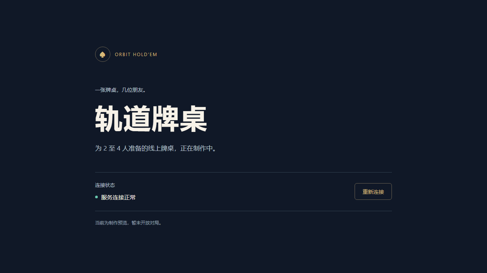

# W03验证与交接记录

日期：2026-10-30。状态：工程骨架及本地验证完成，M0仍待W04灰盒布局。

## 交付范围

建立web/server/poker-core/protocol四个npm工作区、精确锁定的依赖、严格TypeScript项目边界与统一命令。Node24.14.1、npm11.11.0，实际依赖和官方来源见[依赖记录](../dependencies.md)。安装、端口和命令见[开发说明](../development.md)。当前目录未初始化Git，未提交或推送。

服务端通过同一HTTP实例提供`GET /health/live`和Socket.IO传输，健康响应为200/`{"status":"ok"}`，未知路由404。工厂可重复关闭并释放端口；浏览器WebSocket握手按配置Origin接受/拒绝。无Origin的原生工具允许连接，此限制不代表身份认证。

React启动页显示“轨道牌桌”、开发阶段说明与真实连接状态。Vite代理`/health`和`/socket.io`；请求失败或HTTP错误时显示失败文案，支持重试、5秒超时及卸载取消。此页面不包含建房、下注或牌桌行为。

W02的三个协议声明、14组JSON样例和W01资料保持原始指纹。生成器从JSON输出带`satisfies`的真实字面量，纳入每次typecheck，覆盖请求/响应/推送；额外静态用例补足历史、会话、房间及中止分支。没有通过类型强制转换或关闭strict让夹具通过。W02报告的`typescriptCompiled: false`是历史审计范围，本轮真实编译结果在[w03-validation.json](w03-validation.json)中为true。

## 实际验证

所有命令从poker-four目录执行，Windows使用npm.cmd。

| 检查 | 结果 | 证据/范围 |
|---|---|---|
| `npm ci --no-fund` | 退出0 | 98个依赖包，audit 0；清理已知TypeScript构建输出后重建 |
| `npm run test:fixtures` | 退出0 | W01的74场景、W02的14样例与16帧；仍是资料审计 |
| `npm run typecheck` | 退出0 | 共享包、服务端、前端、测试与工具配置，含生成字面量 |
| `npm run test:integration -- --reporter=default --reporter=json --outputFile=docs/verification/w03-vitest.json` | 退出0 | 4文件、13通过、0失败/跳过 |
| `npm run format:check` | 退出0 | 新增代码与配置，旧基线不批量格式化 |
| `npm run build` | 退出0 | 先完整类型检查，再共享包/服务端ESM与前端dist |
| `npx playwright install chromium` | 退出0 | Playwright Chromium实际安装；本轮使用其浏览器运行 |
| `npm run test:e2e` | 退出0 | Chromium 3通过、0失败/跳过 |
| `npm run start` | 启动和健康验证通过 | 编译后入口监听临时端口，HTTP200，停止后端口释放 |
| `npm run test:core` | 按预期退出1 | W05前没有规则用例；不计为成功测试，也不加入W03 CI |

13项集成由生成器2项、契约资料2项、HTTP/Socket生命周期7项、实际统一dev命令2项组成。传输用例建立实际WebSocket连接；开发命令用例实际启动前后端、检查端口占用导致整体非零退出，以及停止后3001/5173释放，不关闭未知监听者。

3项浏览器用例分别为真实页面→Vite→后端健康响应、受控拒绝请求后取消拦截并重试恢复、受控HTTP503失败提示。正常用例没有伪造健康响应；后两项验证浏览器错误处理，不冒称真实网络故障实验。启动截图为1280×720并已人工查看，无内容重叠；不替代W04多视口牌桌布局验收。

[集成机器报告](w03-vitest.json)、[浏览器机器报告](w03-playwright.json)、[最终命令原始输出](w03-commands.json)、[编译后启动报告](w03-production-start.json)。共享包的公开ESM入口也由Node实际导入成功。

## 失败与恢复证据

实现前观察到缺失生成器/服务端入口和未完成页面导致相应测试失败，再补齐实现使其通过。审查发现tsx watch可掩盖初始启动失败，以及仅配置CORS不能拒绝WebSocket握手；对应失败测试已复现并在修复后通过。

启动修复增加双端口预检查和本监视进程15秒就绪守卫；来源修复使用Socket.IO `allowRequest`。修复Windows启动竞态时，仅停止了已确认属于本项目测试的遗留Vite进程，未清理未知服务。只读复审未发现剩余阻断项。

负向类型探针临时移除容量用例的`@ts-expect-error`，编译器以TS2322拒绝容量5并退出2；finally恢复原始字节后同一编译命令退出0，见[负向探针报告](w03-type-negative.json)。这证明类型检查会拒绝该非法结构，不证明所有number金额在运行时合法。

## CI、限制与交接

GitHub Actions已配置Windows/Ubuntu的Node、Python、npm ci、资料/类型/集成/格式/构建和Chromium启动检查。本轮没有Git远程执行证据，不宣称CI已运行或Ubuntu已实测。workflow假定未来poker-four为仓库根；若采用外层根目录，需要调整位置和工作目录。

规则引擎、身份与权限、运行时业务校验、房间事件、数据库、电脑、完整多人对局E2E和公网部署均未实现。core仍为空模块；不存在伪造成功的牌局方法或空测试通过。当前start只提供后端，前端生产同域托管留W39。

W03预计3—4小时；实际专注工时未可靠计时。下一步W04：灰盒首页/等待页/牌桌及2/3/4人布局，本轮未开始。详见[已勾选执行计划](../../../plan/07-第三步-W03工程骨架与验证环境.md)与[任务日志](task-log.md)。
